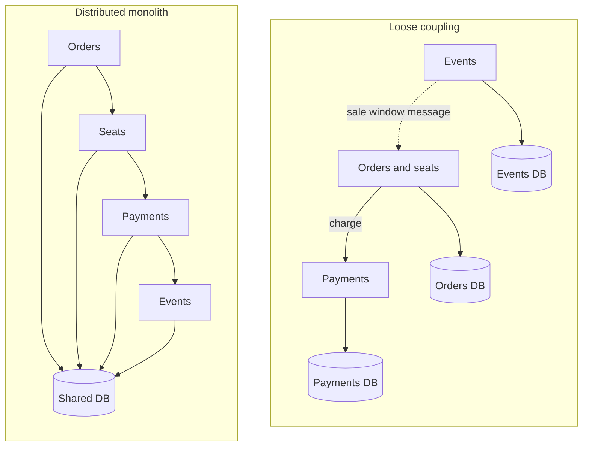

# Coupling and Cohesion

> Coupling is how much one part of a system depends on the others, and cohesion is how well the things inside one part belong together. Aim for loose coupling and high cohesion, so most changes stay inside one box.

## How it works

Larry Constantine worked out both ideas in the 1960s, and they reached a wide audience through the 1974 paper Structured Design, written with Wayne Stevens and Glenford Myers.

Coupling is about what breaks when something else changes. Between services, it shows up in a few ways, from mild to painful:

- **API contracts.** Service A calls B's documented API. B can rewrite its insides freely. This is the healthy kind.
- **Shared tables.** Two services read and write the same tables. Rename a column and both break.
- **Live calls.** A can only answer while B is up, because it calls B on every request.
- **Shared releases.** A and B must ship together because they share a library or a message format that just changed.

Cohesion is the other side. A cohesive service holds things that change together: an order, its line items, and its status rules. A low cohesion service is a junk drawer, like a `utils` service that sends email, resizes images, and calculates tax.

The two move together. When related things sit in one place, fewer calls have to cross a boundary, so coupling drops too.

The catch: the distributed monolith. A team splits a monolith into 10 services, but they still share one database, call each other in long chains where each one waits on the next, and must deploy in lockstep. They now have all the coupling of the monolith plus network failures, extra latency, and 10 pipelines. Splitting code apart does not reduce coupling. Drawing the boundaries around cohesive pieces does.

## Example

A ticketing site split into events, seats, orders, and payments services. All four read and write one Postgres database. Buying a ticket calls orders, which calls seats, which calls payments, which calls events to check the sale is still open.

A big concert goes on sale. The events service slows down under load, every service in the chain waits on it, and checkout times out. Even adding a `presale` column to the events table needs a coordinated release of all four.

The fix: each service owns its tables, and nobody else touches them. Seats and orders merge, because holding a seat and creating an order always change together. Events publishes the sale window as a message, and the order service keeps its own copy, so a slow events service no longer blocks checkout. The next presale change ships in one service.

## Picture it

In the distributed monolith, one slow service stalls the whole chain, and every service shares one database. With loose coupling, orders and seats are one cohesive service, the sale window arrives as a message, and each service owns its own data.

## Related

[Monolith vs Microservices](../15-architecture/monolith-vs-microservices.md) · [Single Responsibility Principle](single-responsibility-principle.md) · [Event Driven Architecture](../13-messaging/event-driven-architecture.md) · [Domain Driven Design](../15-architecture/domain-driven-design.md) · [Conway's Law](../23-laws/conways-law.md)

---

[← Single Responsibility Principle](single-responsibility-principle.md) · [All concepts](../../README.md) · [Premature Optimization →](premature-optimization.md)
