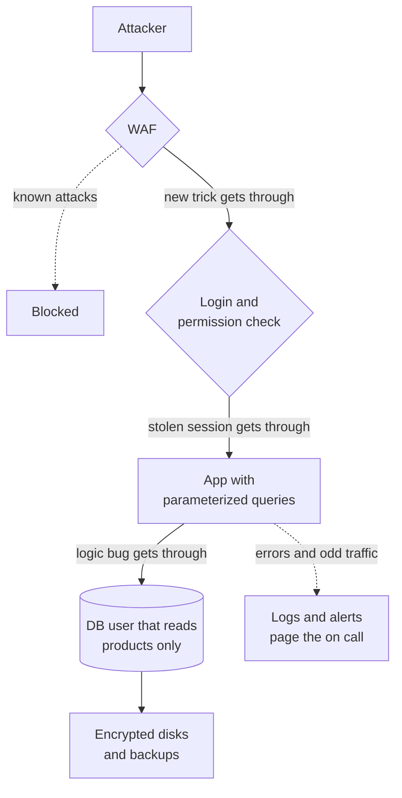

# Defense in Depth

> Defense in depth stacks several independent security layers, so an attacker has to beat all of them. When one control fails, and one always does eventually, the next one is still standing.

## How it works

The name is borrowed from military strategy, where you defend with several lines instead of one wall. The US Department of Defense made it official policy for its computer systems in 2002.

Every single control has holes. Firewall rules get misconfigured, libraries ship bugs, people click phishing links. So you put several different controls in a row, and each one assumes the one before it already failed.

A typical web app stacks them like this:

- **Edge.** A web application firewall (WAF) and rate limits drop known attack patterns and floods.
- **Identity.** Every request is authenticated, and every action is checked for permission.
- **Code.** Parameterized queries and input validation stop injection even when the WAF misses it.
- **Data.** The app connects as a database user with only the rights it needs, and disks and backups are encrypted.
- **Detection.** Logs and alerts catch the attack that got through, so you find out in minutes instead of months.

The layers need to be independent. Three checks that all trust the same header from the API gateway are one layer, not three. Forge the header once and you're past all of them.

Watch out: layers turn into excuses. "The WAF will catch it" is how unsafe SQL ships. Build each layer as if it were the last one. And stacking controls nobody tunes just gives you more alerts that everyone learns to ignore.

## Example

An online store has a product search box. A new endpoint builds its SQL by gluing strings together, and an attacker types `' OR 1=1 --` into it.

The WAF has a rule for that pattern and blocks it. The attacker tries an encoded version the rule doesn't know, and that one gets through. The query runs.

But search connects as `search_ro`, a read only user that can see the `products` table and nothing else. No customer emails, no orders, no admin accounts. Card numbers were never in this database, because the payment provider holds them. Meanwhile an alert fires: 400 database errors in one minute from a single IP. The on call engineer blocks it, and the parameterized query fix ships that afternoon.

One layer failed and one was missing. The store still lost nothing worth a headline.

## Picture it

Follow the attacker from top to bottom. Each layer stops some attacks and lets a few through, and the next one is built assuming the last one already failed. The alerts on the side catch whatever slips past them all.

## Related

[WAF](../17-web-security/waf.md) · [SQL Injection](../17-web-security/sql-injection.md) · [Principle of Least Privilege](principle-of-least-privilege.md) · [Encryption at Rest](../16-identity-and-encryption/encryption-at-rest.md) · [Zero Trust](../16-identity-and-encryption/zero-trust.md)
