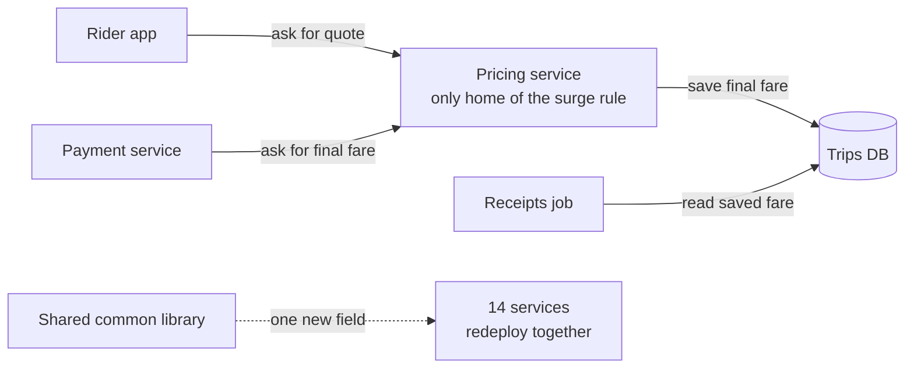

# DRY

> DRY, short for "don't repeat yourself", says every piece of knowledge in a system should live in exactly one place. It is about rules and facts, not about code that merely looks alike.

## How it works

Andy Hunt and Dave Thomas coined it in The Pragmatic Programmer in 1999. They asked for a "single, unambiguous, authoritative representation" of each piece of knowledge.

Knowledge means a business rule, a schema, a config value, a message format. If the rule that orders over $50 ship free lives in the checkout service, the mobile app, and the email template, every change has to hit all three, and one of them will be missed. That is the duplication DRY is aimed at. In a 2003 interview, Thomas said it covers database schemas, test plans, the build system, and even documentation, not just code.

Ways to keep one source of truth in a real system:

- **One owner.** The pricing service owns the free shipping rule. Everyone else asks it.
- **Generate, don't copy.** Write the API schema once and generate clients and validators from it.
- **One config home.** The limit lives in one config store, not in five copies of a constant.

Watch out: two pieces of code that look the same are not always the same knowledge. Shipping fees and tax might both round to two decimals today, but they change for different reasons and on different days. Merge them and you get the wrong abstraction. Sandi Metz argued that a little duplication costs far less than that. The service version of this trap is a shared library every service imports. Put shared models in it, and one new field forces every service to upgrade and redeploy together. You traded duplicated lines for coupled deploys.

## Example

A ride sharing app has a surge pricing rule: multiply the fare by demand over supply, capped at 3 times. The rule was written three times, in the rider app for estimates, in the pricing service that sets the final charge, and in the receipts job that emails a summary.

The cap drops to 2.5 times. The pricing service gets updated, the other two don't. Riders see estimates higher than what they pay and cancel, and receipts disagree with card charges, so support tickets pile up.

The fix: the pricing service is the only home of the rule. The app asks it for a quote, and the receipts job reads the final fare saved with the trip.

Then the team overcorrects. They move the `Trip` model, the HTTP client, and pricing helpers into a `common` library used by all 14 services. Now one new field on `Trip` means 14 version bumps and a coordinated release. Sharing the rule was right. Sharing the code was not.

## Picture it

The surge rule lives in exactly one box, and everything else asks that box or reads what it saved. The dotted line at the bottom is the trap: shared code that ties 14 deploys together.

## Related

[Coupling and Cohesion](coupling-and-cohesion.md) · [Single Responsibility Principle](single-responsibility-principle.md) · [Dependency Hell](../19-build-and-infra/dependency-hell.md) · [Monolith vs Microservices](../15-architecture/monolith-vs-microservices.md) · [Schema Versioning](../07-databases/schema-versioning.md)
