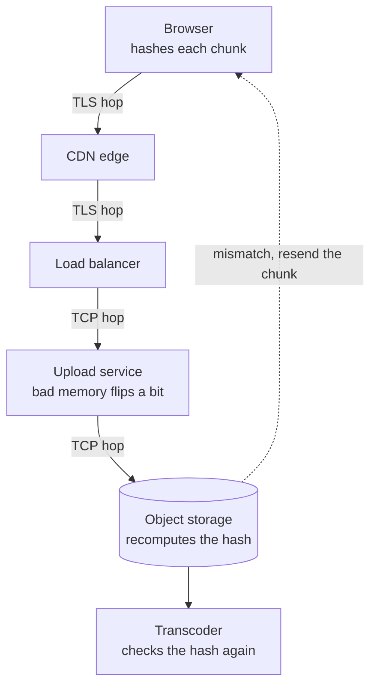

# End to End Principle

> Some guarantees, like "this file arrived intact", can only be checked by the two ends that care about the result. Lower layers can make them faster, but they can't make them correct.

## How it works

Jerome Saltzer, David Reed, and David Clark laid it out in a paper presented in April 1981 and published in revised form in ACM Transactions on Computer Systems in November 1984.

Their example is a careful file transfer from computer A to computer B. Things can go wrong at every step: a bad disk read, a bug in the transfer program, a memory glitch in either computer, the network, a crash halfway through. You could add a check to every step, and you would still miss whatever goes wrong between the checks. The only test that covers the whole trip: B reads the file back from its disk, computes a checksum (a short fingerprint of the bytes), and sends it to A to compare with the original's. If they differ, try again.

So per hop reliability becomes optional. A more reliable network still helps, because fewer transfers fail and fewer retries happen. But it is a speed boost, not the guarantee.

The paper has a war story. A network at MIT checked every hop between its gateways, so programmers trusted it. One gateway had a fault that swapped pairs of bytes while copying data between its own buffers, about once per million bytes, where no check looked. Operating system source files got corrupted, and their owners had to repair them by hand from old printouts.

The same reasoning covers encryption, duplicate detection, and delivery receipts. The application at each end has to own them.

The catch: "we use TCP, so the data is fine." TCP's checksum is only 16 bits, and it only covers one connection, from one machine's network stack to the next. Every proxy, load balancer, and app server in the middle holds your bytes in memory where nothing checks them.

## Example

A video streaming site takes creator uploads. A 2 GB file goes from the browser through a CDN edge, a load balancer, and an upload service that buffers chunks in memory, then into object storage. Every hop runs over TCP, the first two inside TLS too, so every hop has its own integrity check.

One upload server has a bad memory module that flips a bit every few gigabytes. A handful of videos a week come out with green smears in the middle. Every hop's check passed, because the damage happened inside a server, between hops.

The fix is end to end. The browser computes a SHA256 hash of each chunk before sending it, and the hash rides along with the upload. Object storage recomputes it and rejects any mismatch, which S3 supports with the `x-amz-checksum-sha256` header. The transcoder, which converts the video into streaming formats, checks the hash again before it starts. Corrupt uploads now fail loudly and retry, instead of quietly going live.

## Picture it

Each hop has its own check, but none of them sees the bit flip inside the upload service. Only the hash made in the browser, and checked again at storage and at the transcoder, covers the whole trip.

## Related

[TCP vs UDP](../04-networking/tcp-vs-udp.md) · [Object Storage](../08-storage/object-storage.md) · [Encryption in Transit](../16-identity-and-encryption/encryption-in-transit.md) · [Idempotency](../14-reliability/idempotency.md) · [Retries](../14-reliability/retries.md)

---

[← Chesterton's Fence](../23-laws/chestertons-fence.md) · [All concepts](../../README.md) · [Principle of Least Privilege →](principle-of-least-privilege.md)
