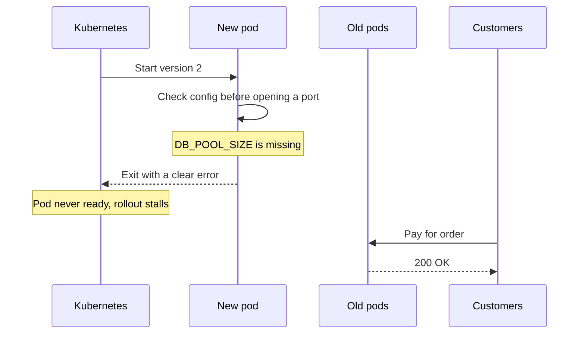

# Fail Fast

> Fail fast means stopping with a loud, clear error the moment something is wrong, instead of limping along on bad data. A crash at startup is cheap, while a quiet wrong answer in production is expensive.

## How it works

Jim Shore made the case in a 2004 IEEE Software column. His example was a config reader that quietly fell back to a default when a setting was missing. The app kept running, got mysteriously slow for customers, and tracking down why could take days. An error naming the missing setting would have been a 30 second fix.

In a running system, fail fast shows up in three places:

- **At startup.** Check every required env var, secret, and config value before taking traffic. If one is missing or malformed, exit with an error that names it.
- **At the edge of a request.** Validate input at the API and reject a bad request with a 400, instead of passing garbage deeper into the system.
- **When calling a dependency.** A timeout caps how long you wait. A circuit breaker goes further: once a dependency keeps failing, it returns an error right away instead of waiting at all.

Startup checks pair well with orchestration. In Kubernetes, a pod that exits during a rolling deploy never becomes ready, so the rollout stalls and the old pods that are still up keep serving.

The catch: fail the smallest thing that is actually broken. One malformed request should get a 400, not crash the process and the 200 other requests it was handling. Shore himself recommends a top level error handler that reports the problem and keeps the rest of the system going. And a service that refuses to start because an optional dependency is down for a minute just turns a blip into a crash loop, where it restarts over and over and never serves anyone.

## Example

A payments API reads `DB_POOL_SIZE` from the environment. A new deploy has a typo, `DB_POOL_SIZ=50`, so the code silently falls back to a default of 2 connections. Every pod starts, passes its health check, and takes traffic. At the lunch peak, requests queue up for database connections, checkout latency climbs from 120 ms to 9 seconds, and the on call engineer needs an hour to find the typo.

With fail fast, the service checks its config before it opens a port:

```python
import os, sys

pool_size = os.environ.get("DB_POOL_SIZE")
if pool_size is None:
    sys.exit("missing required env var DB_POOL_SIZE")
```

The new pods exit on boot and never become ready. The rollout stalls, the old version keeps taking payments, and the engineer reads the error in the deploy log and fixes it in a minute.

## Picture it



The new pod dies at startup with an error that names the problem. Because it never becomes ready, the old pods keep serving payments, so a config typo costs a minute instead of a lunch rush.

## Related

[Circuit Breakers](../14-reliability/circuit-breakers.md) · [Timeouts](../14-reliability/timeouts.md) · [Liveness and Readiness Probes](../14-reliability/liveness-and-readiness-probes.md) · [Rolling Deployments](../20-releases/rolling-deployments.md) · [Twelve Factor App](twelve-factor-app.md)
