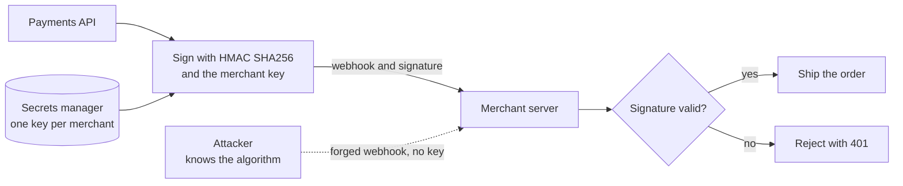

# Kerckhoffs's Principle

> A security system should stay safe even if attackers know everything about it except the key. Keep the secret small, so when it leaks you change a key instead of redesigning the whole system.

## How it works

Auguste Kerckhoffs set it down in 1883, in a two part article on military ciphers called La cryptographie militaire. Of his six rules, the second says the system must not depend on secrecy and must survive falling into enemy hands. Claude Shannon restated it in 1949, telling cryptographers to assume "the enemy knows the system being used."

Why it holds: systems are hard to hide. Code ships inside apps, sits in public repos, gets decompiled, leaks with a stolen laptop, or walks out with a former employee. Shannon's point was that your system will be found out eventually. A key, on the other hand, is small and easy to replace. If your safety depends on the algorithm staying secret, one leak breaks every deployment at once, and the fix is a new design.

That is also why you don't roll your own crypto. Public algorithms like AES and HMAC, a way to sign messages with a secret key, have survived years of attack by professional cryptographers. Your homemade scheme has survived you. Security through obscurity, staying safe only because attackers don't know how things work, fails the first time someone looks.

In practice:

- **Standard algorithms.** Use a vetted library: TLS for traffic, `AES-GCM` for data, HMAC for signatures, bcrypt or Argon2 for passwords.
- **Secrets in keys only.** Keep keys in a secrets manager and rotate them on a schedule.
- **Assume the code is public.** Mobile apps and browser code effectively are.

Watch out: obscurity is fine as an extra layer. Moving SSH off port 22 cuts noise from scanners. It just can't be the thing that keeps you safe.

## Example

A payments API sends webhooks to merchants, like "payment succeeded for order 8812". Version 1 proved they were genuine with an in house trick: a header built by reversing the body, mixing in the timestamp, and base64 encoding the result. There was no key. The recipe was the secret.

The recipe also sat in the open source SDK that merchants install. Once someone read it, anyone could forge a "payment succeeded" webhook to any merchant and get goods shipped for free. With no key to rotate, the only fix was a new scheme for every merchant at the same time.

Version 2 follows Kerckhoffs. It signs each webhook with HMAC using SHA256 and a secret key per merchant, the same public approach Stripe documents for its webhooks. The algorithm is in every textbook. If one merchant's key leaks, you rotate that one key and nobody else notices.

```http
POST /webhooks/payments HTTP/1.1
X-Signature: t=1718000000,v1=f5ba5aec1d5ec6316f291cfa90daca00961f8e626a9d4367c3fb0952404a5a2d
```

## Picture it



The attacker knows the algorithm completely and still can't produce a valid signature, because the key lives only in the secrets manager and with the merchant. All of the secrecy sits in that one small, replaceable key.

## Related

[Secrets Management](../16-identity-and-encryption/secrets-management.md) · [Encryption at Rest](../16-identity-and-encryption/encryption-at-rest.md) · [TLS](../16-identity-and-encryption/tls.md) · [Webhooks](../05-apis/webhooks.md) · [Defense in Depth](defense-in-depth.md)

---

[← Defense in Depth](defense-in-depth.md) · [All concepts](../../README.md) · [KISS →](kiss.md)
