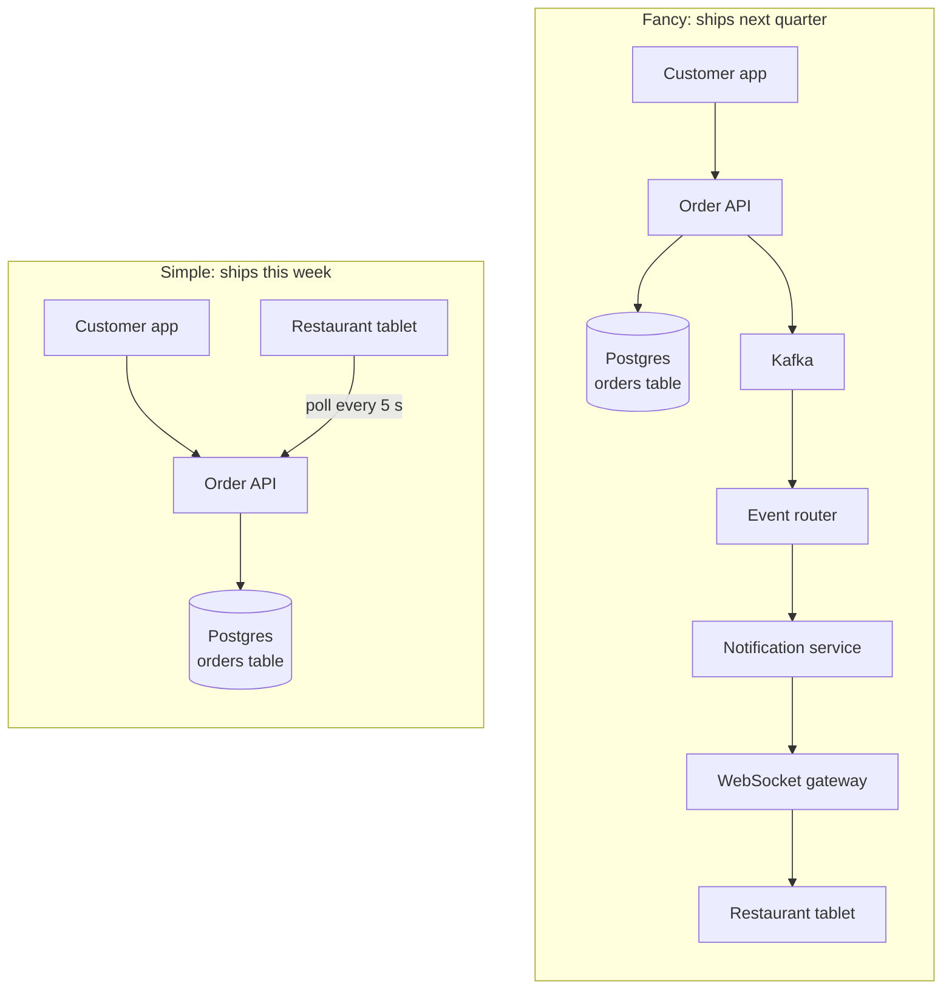

# KISS

> KISS stands for "keep it simple, stupid". Pick the simplest design that meets the real need, because every extra moving part is one more thing to build, learn, watch, and fix at 3 a.m.

## How it works

Lockheed's own history calls it the favorite maxim of Kelly Johnson, who ran its Skunk Works, the team that built the world's first dedicated spy plane. The US Navy was using the phrase by 1960 too. As the story goes, Johnson wanted jets an average mechanic could repair in the field with a few basic tools. In that story, the "stupid" was never aimed at the engineers. It was aimed at designs too clever to fix under pressure.

In software, simple means fewer moving parts, not fewer lines of code. Every component you add, a queue, a cache, a second database, a service mesh, brings its own failure modes, upgrades, dashboards, and pages in the night.

For each part, ask two questions. What problem does this solve today? What breaks if I leave it out? A few habits help:

- **Start boring.** One app, one Postgres database, one deploy pipeline. That handles more traffic than most products ever see.
- **Add parts for measured pain.** Add a cache when the database is actually slow, and a queue when work actually needs to happen later.
- **Prefer what the team knows.** A tool everyone can debug beats a better one that only one person understands.

The catch: simple is not the same as naive. Skipping backups, timeouts, or input validation isn't simplicity, it's a missing requirement. And a design can be too simple for the job. One server with no replica doesn't meet the need of a payments system that must survive losing a data center. KISS means the simplest design that works, not the simplest design you can draw.

## Example

A food delivery startup handles about 3,000 orders a day, with a dinner peak of maybe 10 a minute. The first design for alerting restaurants about new orders has Kafka, an event router, a notification service, and a WebSocket gateway. That is four new systems to deploy, monitor, and understand.

The simple version: the order lands in the `orders` table in Postgres, and each restaurant tablet asks `GET /orders?status=new` every 5 seconds. With 400 restaurants open, that's 80 tiny requests a second, which one app server and an index on restaurant and status handle without noticing.

It ships in a week instead of a quarter. When thousands of restaurant tablets are polling every few seconds and it starts to cost real money, they add push updates. By then they know exactly where it hurts.

## Picture it

Both designs get a new order onto the restaurant's tablet within seconds. The simple one has four boxes to run and debug. The fancy one has eight, and at 10 orders a minute it buys nothing the simple one lacks.

## Related

[Gall's Law](../23-laws/galls-law.md) · [YAGNI](yagni.md) · [Premature Optimization](premature-optimization.md) · [Monolith vs Microservices](../15-architecture/monolith-vs-microservices.md) · [Long Polling](../04-networking/long-polling.md)

---

[← Kerckhoffs's Principle](kerckhoffs-principle.md) · [All concepts](../../README.md) · [YAGNI →](yagni.md)
