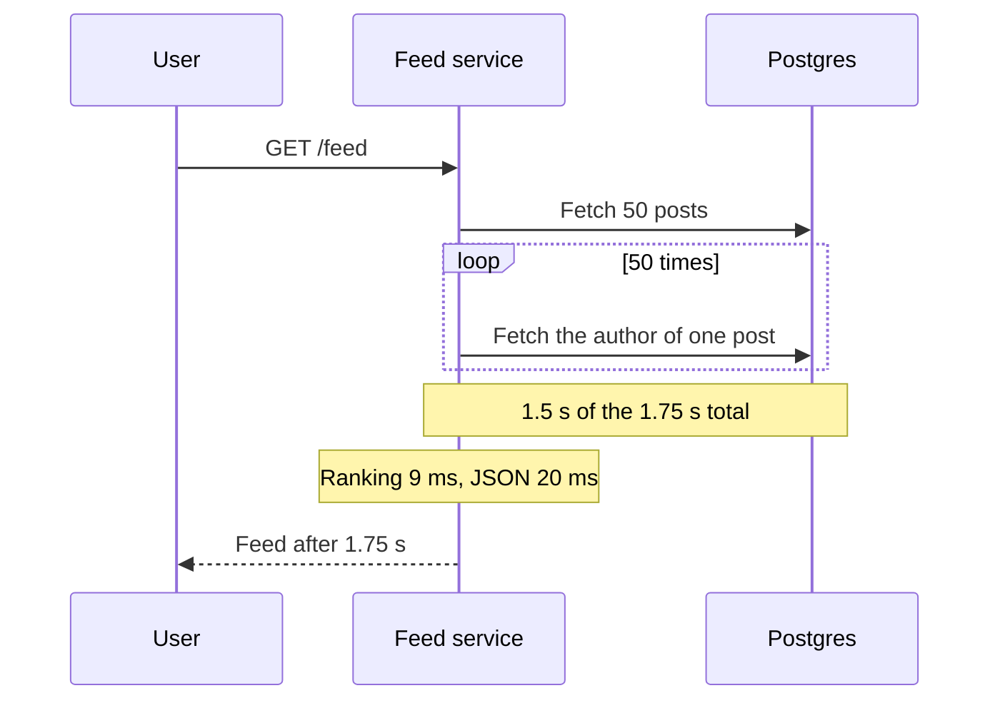

# Premature Optimization

> Premature optimization is tuning code for speed before you know it is slow, which costs time and clarity and usually speeds up the wrong thing. Measure first, then fix the part that actually matters.

## How it works

Donald Knuth wrote the famous line in a 1974 paper on structured programming: "premature optimization is the root of all evil". The sentences right after it are the part people forget. He said not to pass up the critical 3 percent of code where speed really matters, but to find that code first, because programmers who measure keep learning that their guesses about it are wrong.

So the rule is not to ignore speed. It is to optimize what you measured.

In a real system, time rarely goes where you expect. A request that takes 900 ms might spend 2 ms in your clever loop and 850 ms waiting on the database or a third party API. These tools tell you where it really goes:

- **Profilers.** They show which functions burn the CPU.
- **Distributed tracing.** It shows how long each hop of a request takes, across every service it touches.
- **Slow query logs.** They show which database queries are slow and how often they run.
- **Load tests.** They show what falls over first, before your users find it.

The catch: the quote gets used as an excuse to never think about performance. Some choices are expensive to change later and deserve thought up front: the data model, an index for the query that runs on every page load, keeping network calls out of loops, an algorithm whose cost doesn't explode when the table grows from 1,000 rows to 10 million. That is design, not premature optimization.

## Example

A social feed takes 1.8 seconds to load, and everyone agrees that's too slow. One engineer spends two weeks swapping in a faster JSON library and hand tuning the ranking function. The feed now loads in 1.75 seconds.

Then someone turns on tracing. It shows 1.5 of those 1.75 seconds spent in the database. The feed fetches 50 posts, then runs one more query per post to get its author: 51 queries for one page. Ranking takes 9 ms.

One query that joins posts with their authors, plus an index on `posts(user_id, created_at)`, brings the feed down to about 300 ms in an afternoon. The two weeks of JSON tuning went into code that was never the problem.

## Picture it

The trace makes the answer obvious. Almost all the time sits in 51 small trips to the database, not in the ranking or JSON code the team tuned first.

## Related

[N+1 Queries](../07-databases/n-plus-one-queries.md) · [Distributed Tracing](../18-observability/distributed-tracing.md) · [Load Testing](../22-operations/load-testing.md) · [Amdahl's Law](../23-laws/amdahls-law.md) · [Pareto Principle](../23-laws/pareto-principle.md)

---

[← Coupling and Cohesion](coupling-and-cohesion.md) · [All concepts](../../README.md) · [Fail Fast →](fail-fast.md)
