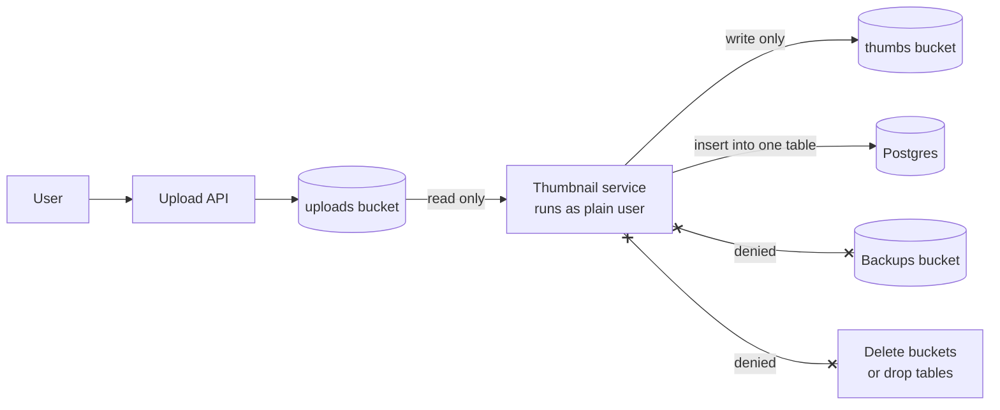

# Principle of Least Privilege

> Give every user, service, and process only the permissions it needs for its job, and nothing more. When something gets hacked or goes wrong, the damage stops at that small set.

## How it works

Jerome Saltzer and Michael Schroeder listed it as a core design rule in their 1975 paper on protecting information in computer systems. The cloud just gave it a lot more places to apply.

Every identity in your system gets one narrow job and access to match:

- **Cloud roles.** The thumbnail service can read one storage bucket and write to another. It cannot delete buckets, read backups, or touch billing. IAM policies are where you write this down.
- **Database users.** The reporting job connects as a read only user. The app can read and write its own tables but cannot drop them. Only migrations run as the owner.
- **Containers.** Run as an ordinary user instead of root, drop Linux capabilities you don't use, and mount the filesystem read only where you can.
- **People.** Engineers get production access when they need it, for a few hours, not forever.

The payoff is a smaller blast radius, meaning how far the damage spreads. A leaked key that can only read thumbnails is an annoyance. A leaked admin key is a headline.

The catch: permissions only ever grow. Someone hits "access denied" during a 2 a.m. deploy, attaches an admin policy to unblock it, and nobody ever takes it back. Review permissions on a schedule. AWS and Google Cloud can both show which permissions a role hasn't used lately. Going too far hurts as well. If every change needs a ticket and a week of approvals, people start sharing one powerful account to get work done, which is worse than where you started.

## Example

A photo sharing app has a thumbnail service. It reads new uploads from one bucket and writes small versions to another. To ship fast, the team gave it `s3:*` on all 14 buckets and connected it to Postgres as the database owner.

Then an image parsing bug lets an attacker run code inside the thumbnail container. With that setup, they can delete every photo ever uploaded, download the bucket of nightly database backups, and drop the users table.

The fix is three small changes. The role allows reading `uploads` and writing `thumbs`, nothing else. The service gets its own database user that can only insert into the `thumbnails` table. The container runs as an unprivileged user with a read only filesystem. Same bug, same attacker, and now the worst they can do is read uploads and write junk thumbnails. Still a bad day, but a much smaller one.

## Picture it

The solid arrows are the only things the thumbnail service is allowed to do. The crossed lines are what an admin role would also have handed an attacker. Least privilege shrinks the blast radius down to the solid arrows.

## Related

[IAM](../16-identity-and-encryption/iam.md) · [Role Based Access Control](../16-identity-and-encryption/role-based-access-control.md) · [Defense in Depth](defense-in-depth.md) · [Zero Trust](../16-identity-and-encryption/zero-trust.md) · [Secrets Management](../16-identity-and-encryption/secrets-management.md)
