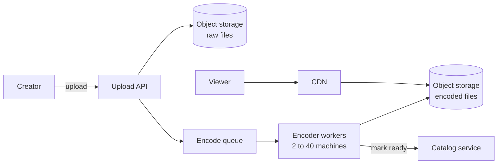

# Separation of Concerns

> Separation of concerns means splitting a system so each part handles one kind of problem, like storage, business rules, or display. Then you can understand, change, and scale each part without dragging the others along.

## How it works

The name comes from a 1974 essay by Edsger Dijkstra. His point was about thinking clearly: study one aspect of a problem at a time, like whether a program is correct, and deliberately set the others aside for now, like whether it is fast.

In code, that becomes layers. The web layer turns HTTP and JSON into calls. The business layer knows the rules. The data layer talks to the database. A change to the page layout should never touch the SQL.

In a system, the same idea shows up at a bigger scale:

- **One job per service.** Uploads, video encoding, the catalog, and playback each live in their own service with their own data.
- **Shared plumbing pulled out.** TLS, auth checks, retries, and request logging move into an API gateway or a sidecar proxy, a small helper process running next to each service, so business code doesn't repeat them.
- **Reads split from writes.** Some systems give the write path and the read path separate models, because their needs are so different.

The payoff is that each concern can scale and fail on its own. Encoding needs big CPUs in bursts. The catalog needs a fast database. Mix them in one server and you size every machine for the worst of both.

The catch: a concern is a reason things change, not a layer for its own sake. Splitting a tiny app into controller, service, manager, repository, and mapper classes for one table gives you five files to edit for every change. And splitting services by technical layer, like a "database service" every other service must call, separates nothing. It just adds a network hop.

## Example

A video streaming site started as one web app that accepted an upload and transcoded it right inside the HTTP request. A 2 GB file tied up a web worker for 20 minutes. Ten creators uploading at once made pages slow for every viewer, and an encoder crash took the whole site down with it.

The team splits it by concern. The upload API only saves the raw file to object storage and puts a job on a queue. A pool of encoder workers turns it into four resolutions. The catalog service stores titles and metadata. Playback is a CDN serving the encoded files.

Now the encoder pool grows from 2 to 40 machines on a busy evening without touching the web tier. When an encoder crashes, its job goes back on the queue, and viewers never notice.

## Picture it

Each box owns one job: taking uploads, encoding, describing videos, or serving bytes. The encoder pool can grow, shrink, or crash, and the viewer's path through the CDN never feels it.

## Related

[Single Responsibility Principle](single-responsibility-principle.md) · [Coupling and Cohesion](coupling-and-cohesion.md) · [Message Queues](../13-messaging/message-queues.md) · [Service Mesh](../15-architecture/service-mesh.md) · [CQRS](../13-messaging/cqrs.md)
