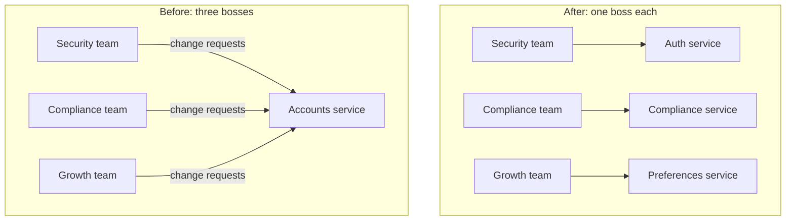

# Single Responsibility Principle

> A module, class, or service should have only one reason to change, which in practice means it answers to one group of people. Then a change one team asks for can't quietly break another team's feature.

## How it works

Robert C. Martin coined the single responsibility principle (SRP) in the late 1990s, and it became the S in SOLID. His first wording was one reason to change. Plenty of people read that as each module doing just one thing, which Martin says is a separate rule meant for small functions. In his book Clean Architecture he restated it: a module should be responsible to one actor, meaning one group of people who ask for its changes.

His example is an `Employee` class with three methods. Pay calculation belongs to finance. Hours reporting belongs to HR. Saving to the database belongs to the tech team. Three bosses, one class. When finance tweaks how regular hours are counted and that logic is shared, the HR report quietly starts showing wrong numbers.

The fix is to split along those lines so each piece has one boss. The same test works for services:

- **Ask who files the tickets.** If three different teams keep requesting changes to one service, it probably has three responsibilities.
- **Watch the releases.** If unrelated features keep shipping together and breaking each other, that is a seam asking to be cut.
- **Keep together what changes together.** Martin's shorter version: "Gather together the things that change for the same reasons."

The catch: SRP does not mean one function per service. Taken too far, you get nanoservices, each with 50 lines of code, its own pipeline, its own dashboard, and its own pager. Every feature turns into a five service release. Split by who asks for change, not by verb.

## Example

A wallet app has one `accounts` service. It handles login and two factor codes for the security team, ID checks and spending limits for the compliance team, and email preferences for the growth team.

Compliance adds a new account status, `review`, for customers whose ID check is pending. The change ships on a Friday. Login only lets in accounts marked `active`, so 4,000 customers in review are locked out of their money until Monday. Nobody on the security team even knew the change was coming.

The fix splits by actor. An auth service owned by security handles login. A compliance service owns ID checks, limits, and that status. A preferences service belongs to growth. Each has its own data and its own releases. The next compliance rule ships without anyone wondering whether login still works.

## Picture it

The arrows are change requests. In the before picture, three teams push changes into one service, so any release can break the other two. In the after picture, each service answers to exactly one team.

## Related

[Separation of Concerns](separation-of-concerns.md) · [Coupling and Cohesion](coupling-and-cohesion.md) · [Conway's Law](../23-laws/conways-law.md) · [Domain Driven Design](../15-architecture/domain-driven-design.md) · [Monolith vs Microservices](../15-architecture/monolith-vs-microservices.md)
