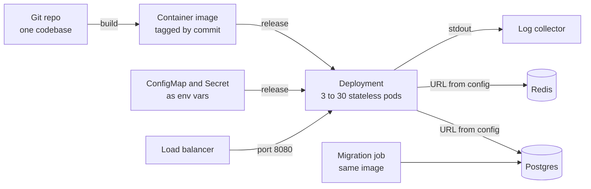

# Twelve Factor App

> The Twelve Factor App is a checklist of 12 rules for building web services that deploy cleanly to any cloud and scale by running more copies. It reads like a description of how containers and Kubernetes expect your app to behave.

## How it works

Adam Wiggins, a Heroku cofounder, published it in 2011, drawing on what the Heroku team had seen across hundreds of thousands of apps on its platform. The twelve factors:

| Factor | What it asks for |
|---|---|
| 1. Codebase | One repo per app, deployed many times |
| 2. Dependencies | Declare every library, assume nothing on the host |
| 3. Config | Anything that changes per deploy lives in env vars |
| 4. Backing services | Databases, caches, and queues attach by URL and can be swapped |
| 5. Build, release, run | Build once, add config to make a release, then run it |
| 6. Processes | Stateless processes, with shared state in a backing service |
| 7. Port binding | The app serves HTTP on a port by itself |
| 8. Concurrency | Scale out by running more processes |
| 9. Disposability | Start fast and shut down gracefully |
| 10. Dev/prod parity | Keep dev, staging, and production as alike as possible |
| 11. Logs | Write logs to stdout as a stream and let the platform collect them |
| 12. Admin processes | Run migrations and one off tasks as separate processes |

The big idea is that the same build can run anywhere, with only config changing between environments, and that any copy can be killed or cloned at any time.

The catch: it was written for stateless web apps. Databases, stream processors, and anything that keeps state on local disk don't fit factor 6, and that's fine. Env vars also aren't a great home for secrets everywhere, since they leak through child processes, debug pages, and crash reports, so many teams mount secrets from a secret manager instead. Treat it as a strong default, not scripture.

## Example

A news site's article API runs on Kubernetes, and nearly every factor maps to something concrete.

One Git repo builds one container image, tagged with the commit. The Dockerfile installs from a lockfile that pins every dependency. The Postgres URL and Redis address come from a ConfigMap and a Secret as env vars. The process listens on port 8080 and keeps nothing in memory between requests, so the Deployment scales from 3 to 30 pods when a big story breaks. Pods boot in 2 seconds and finish their in flight requests when Kubernetes sends `SIGTERM`. Logs go to stdout, and a node agent ships them. Schema migrations run as a Kubernetes Job using the same image.

When the team moves to a new Redis cluster, it's a one line config change and a rolling restart. No code change, no rebuild.

## Picture it

Code becomes one image, and config joins it at release time. The same image runs as many interchangeable pods. Databases and caches hang off URLs in config, logs leave through stdout, and migrations run as a separate job from the same image.

## Related

[Docker](../19-build-and-infra/docker.md) · [Kubernetes](../19-build-and-infra/kubernetes.md) · [Stateless Services](../02-scaling/stateless-services.md) · [Secrets Management](../16-identity-and-encryption/secrets-management.md) · [Graceful Shutdown](../14-reliability/graceful-shutdown.md)

---

[← Fail Fast](fail-fast.md) · [All concepts](../../README.md)
