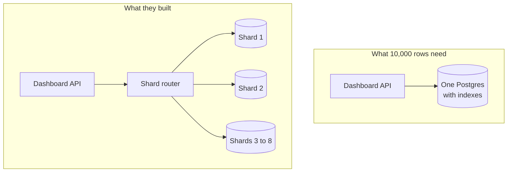

# YAGNI

> YAGNI, short for "you aren't gonna need it", says don't build features or infrastructure for needs you only imagine. Build for the load and requirements you have today, and change the design when a real need shows up.

## How it works

It comes from Extreme Programming, a late 1990s way of working built on short cycles and constant refactoring. Ron Jeffries, one of its founders, wrote it up in 1998: implement things "when you actually need them, never when you just foresee that you need them".

The argument is about cost. Martin Fowler counts several costs of a speculative feature. Three of them:

- **Cost to build.** Weeks spent on something no user asked for.
- **Cost of delay.** The features users did ask for wait in line behind it.
- **Cost to carry.** Every later change has to work around the extra code, config, and servers, whether or not the guess was right.

And the guess is often wrong. By the time you really need multi region failover or a plugin system, the requirements look different from what you predicted, so you end up rebuilding it anyway. Building it later, with real data, is usually cheaper than building it twice.

The catch: YAGNI is about features, not about care. Tests, clean code, and a fast deploy pipeline make future change cheap, and cheap change is exactly what lets you skip the guessing. Skipping those in the name of YAGNI is just debt. Some choices are also expensive to undo, like the shape of a public API or the format of your IDs. Those deserve a little thought before you strictly need them.

## Example

A SaaS dashboard startup has 40 customers and 10,000 rows in its main table. The lead engineer reads how a big company shards Postgres and spends six weeks building the same: 8 shards, a routing layer that picks a shard by customer ID, and a script to move customers between shards.

Now every query needs a shard key. A report across all customers has to fan out to 8 databases and merge the results. A bug in the router writes one customer's widgets to another customer's shard.

10,000 rows fit in memory on the smallest database server you can rent. One Postgres with good indexes would handle 100 times that growth without breaking a sweat. The six weeks could have shipped the CSV export three customers were begging for. If sharding is ever needed, it would be designed around real data about which customers are big.

## Picture it

Both setups serve the same 40 customers. What they built adds a router, eight databases, and a whole new class of bugs. What the data needs is one database that the smallest server can hold in memory.

## Related

[KISS](kiss.md) · [Sharding](../09-data-at-scale/sharding.md) · [Premature Optimization](premature-optimization.md) · [Back of the Envelope Math](../01-performance/back-of-the-envelope-math.md) · [Capacity Planning](../22-operations/capacity-planning.md)
